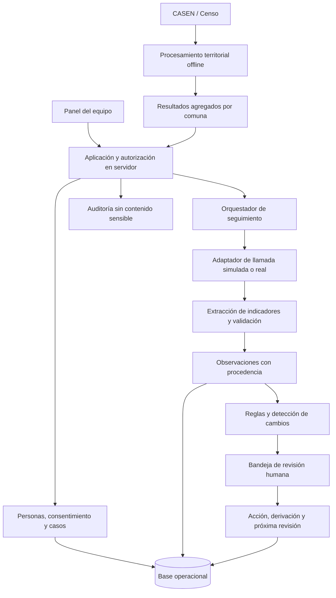

# Etapa 3 · Diseño de FARO

**Funcionalidades, arquitectura, tecnologías y experiencia de usuario**  
Hackathon IA Aplicada · Grupo 01 · 6 de noviembre de 2026  
Estado: propuesta de diseño para construir el MVP; las funciones descritas aún no están implementadas.

## 1. Propuesta de producto y alcance

**FARO es una plataforma de acompañamiento para personas mayores que permite a una institución conocer sus necesidades, realizar seguimientos por voz y coordinar una respuesta humana cuando aparece un cambio relevante.**

El producto conecta tres preguntas: **dónde concentrar recursos, a quién contactar hoy y qué apoyo necesita esa persona**. La unidad de trabajo es un caso de acompañamiento, con responsable, historial y próxima acción.

La institución compra capacidad de seguimiento y coordinación. La persona mayor recibe acompañamiento voluntario y conserva control sobre su participación y sus contactos autorizados. La institución compradora no obtiene por ello acceso irrestricto a las fichas.

### Usuarios

| Usuario | Necesidad | Vista principal |
|---|---|---|
| Monitor o profesional OAM | Saber a quién contactar y dar continuidad | Bandeja de casos y ficha de personas asignadas |
| Coordinación municipal | Distribuir carga y comprobar respuestas | Alertas pendientes, responsables y plazos |
| Profesional CESFAM autorizado | Revisar una derivación y antecedentes pertinentes | Caso compartido y módulo de salud habilitado |
| Persona mayor | Conversar sin instalar aplicaciones y pedir apoyo | Llamada telefónica, con alternativa humana |
| Contacto de confianza | Recibir un aviso específico autorizado | Aviso mínimo decidido por el equipo |
| SENAMA o entidad pública compradora | Planificar cobertura y recursos | Indicadores agregados por territorio |

### Continuidad con el proyecto existente

- **Capa A territorial:** CASEN/Censo alimentan estimaciones agregadas por comuna. Se conserva la separación de los registros nominativos. Sus resultados no equivalen a la probabilidad clínica de una persona inscrita.
- **Capa C individual:** la ficha consentida y los check-ins alimentan observaciones longitudinales, señales y tareas.
- **CRM operativo:** conecta ambas capas con inscripción, permisos, seguimiento y resolución de casos. Los supuestos estadísticos existentes en `PLAN.md` requieren su propia validación; este diseño no acredita el modelo.

Supuestos del MVP: datos individuales sintéticos, demostración local, una institución operadora y dos vistas de rol. La llamada se simula con texto o un audio preparado. La telefonía real y la operación con varias instituciones quedan para el piloto.

## 2. Funcionalidades priorizadas

| Funcionalidad | MVP de hackatón | Evolución para piloto |
|---|---|---|
| Personas | Listar, buscar, filtrar y abrir ficha | Importación validada y gestión de duplicados |
| Inscripción | Registrar preferencias, responsable y consentimiento simulado | Inscripción asistida y evidencia de consentimiento real |
| Ficha personalizada | Resumen, red de apoyo, necesidades e historial | Módulos especializados y nuevos parámetros versionados |
| Seguimiento | Cargar respuesta de una llamada simulada | Llamadas programadas y llamadas manuales asistidas |
| Personalización | Guion basado en preferencias y preguntas pertinentes | Ajuste de ritmo, duración y canal según aceptación |
| Perfil de riesgo | Dimensiones de necesidad, cambios y calidad de datos | Calibración con resultados de un piloto |
| Alertas | Motivo, observaciones de origen, responsable y plazo | Escalamiento operativo y gestión de cobertura |
| Gestión de casos | Revisar, registrar acción, derivar y cerrar | Recepción de la derivación y seguimiento interinstitucional |
| Acceso | Dos vistas sobre datos sintéticos, con filtrado en servidor | Autenticación institucional y autorización completa |
| Territorio | Mostrar ranking existente si está disponible | Seguimiento de cobertura y planificación por comuna |

**Criterio de alcance:** el MVP debe demostrar un ciclo completo, desde una conversación hasta una acción registrada. El mapa territorial es complementario si la capa A todavía no está lista.

## 3. Ficha personalizada y parámetros

La ficha responde cuatro preguntas: **qué es importante para esta persona, qué apoyo tiene, qué ha cambiado y qué acordamos hacer**. Cada campo debe justificar una pregunta, una adaptación o una acción de acompañamiento.

### Parámetros iniciales

| Dimensión | Campos propuestos | Actualización | Uso |
|---|---|---|---|
| Identificación operativa | ID interno, nombre preferido, edad, comuna, teléfono y responsable | Inscripción y corrección | Encontrar y contactar; acceso restringido |
| Preferencias y autonomía | Horario, frecuencia, idioma, trato preferido, temas de interés, preguntas que desea omitir | Inscripción y cuando lo solicite | Personalizar la interacción |
| Accesibilidad | Dificultad para oír o comunicarse, necesidad de hablar más lento, canal alternativo | Inscripción y cambios | Adaptar el contacto; evitar falsas faltas de respuesta |
| Red de apoyo | Vive sola, frecuencia de contacto, quién puede ayudar y contacto autorizado | Inscripción y revisión periódica | Comprender apoyos disponibles |
| Soledad percibida | Cómo se siente respecto de su compañía, si desea más contacto | Pregunta breve y voluntaria | Diferenciar vivir sola de sentirse sola |
| Funcionalidad | Ayuda requerida para desplazarse, comprar, preparar alimentos o realizar actividades cotidianas | Inscripción y cambios | Coordinar apoyos concretos |
| Medicación | Tratamiento vigente autodeclarado, si pudo seguirlo y barreras para acceder o recordar | Cuando corresponda | Detectar necesidad de revisión o apoyo |
| Bienestar cotidiano | Ánimo autodeclarado, alimentación, contacto social y cambios relevantes | Check-in breve | Identificar cambios respecto de su rutina |
| Incidentes | Caída reportada, dificultad nueva o solicitud explícita de ayuda | Cuando se reporte | Abrir revisión humana prioritaria |
| Seguimiento | Intentos, respuestas, alertas, visitas, derivaciones, acuerdos y próxima acción | En cada interacción | Dar continuidad y evitar repetir preguntas |

El nombre, teléfono y dirección se mantienen separados del historial analítico. La dirección exacta se incorpora únicamente si existe una acción que la requiere, como una visita. El MVP usa ID interno y evita solicitar RUT si no es necesario.

Los nombres de medicamentos y sus pautas pueden añadirse en un módulo restringido, con fuente y fecha de verificación profesional. En el primer MVP basta registrar si existe tratamiento y si la persona reporta dificultades. Una respuesta hablada no modifica una prescripción.

### Parámetros para etapas posteriores

Sueño, duelo, participación comunitaria, barreras de transporte, seguridad de la vivienda, acceso a alimentos, sobrecarga del cuidador y necesidades sensoriales pueden añadirse cuando el equipo defina qué acción permiten realizar. Las escalas clínicas o sociales estandarizadas se incorporarán con su redacción, permisos de uso y aplicación profesional correspondientes.

El enfoque de evaluación centrada en la persona y coordinación entre necesidades funcionales y sociales toma como referencia [ICOPE de la OMS](https://www.who.int/publications/i/item/9789240103726). La ficha propuesta es un diseño del equipo; no constituye una escala validada por la OMS.

### Cómo añadir parámetros sin rehacer la ficha

Cada parámetro tendrá una definición: código estable, versión, pregunta, tipo, opciones o unidad, sensibilidad, propósito, roles habilitados, vigencia y uso permitido en reglas. Se añade con un formulario configurable y una revisión de permisos.

Cada observación conserva persona, parámetro y versión, valor, fecha del hecho, fecha de registro, fuente, autor y estado de confirmación. Las correcciones generan una revisión que conserva el historial. Un campo nuevo no cambia las reglas de riesgo hasta que se apruebe una versión que lo utilice.

**Estados de dato:** informado, desconocido, no aplica, prefiere no responder, vencido o pendiente de confirmar. Un vacío no equivale a una respuesta favorable ni desfavorable. Los intereses personales sirven para conversar; no se convierten automáticamente en factores de riesgo.

## 4. Perfil de riesgo explicable

El panel presenta un **perfil de necesidades y prioridad de revisión**, con varias dimensiones. Para el MVP se evita un porcentaje de riesgo que sugiera precisión clínica sin validación.

| Componente | Qué describe | Ejemplo visible |
|---|---|---|
| Necesidades de apoyo | Situación conocida y apoyos disponibles | «Requiere ayuda para comprar; apoyo semanal» |
| Cambios recientes | Diferencia frente a su propia rutina | «Reporta menos contacto social en los últimos seguimientos» |
| Señales puntuales | Un hecho que requiere revisar sin esperar una tendencia | «Solicitó ayuda durante la llamada» |
| Calidad y actualidad | Cuánto sabemos y qué falta confirmar | «Tratamiento informado hace dos meses; actualizar» |

Las dimensiones iniciales son **red social y soledad, autonomía funcional, continuidad del tratamiento, bienestar cotidiano y capacidad de contacto**. Cada una muestra estado, evidencia temporal y acción posible. Se muestra «sin información suficiente» cuando corresponda.

### Motor de prioridad

1. Una señal explícita que requiera atención se presenta de inmediato al equipo conforme al protocolo de cobertura acordado.
2. Las reglas configuradas detectan cambios persistentes o la combinación de señales. La salida incluye los códigos de regla y las observaciones que la originaron.
3. Una falta de respuesta abre primero una situación de contacto: revisar horario, teléfono, accesibilidad y fallas técnicas. La persistencia puede elevar la prioridad según el contexto.
4. Los casos se ordenan por urgencia de revisión, antigüedad y plazo pendiente. Una modificación humana requiere motivo y queda registrada.

| Estado operativo | Ejemplo ilustrativo | Respuesta del equipo |
|---|---|---|
| Seguimiento habitual | Información reciente sin nuevas señales | Mantener el plan acordado |
| Revisar | Cambio respecto de su rutina o dato relevante por confirmar | Asignar revisión con plazo |
| Prioritario | Varias señales persistentes o necesidad relevante reportada | Contactar dentro del plazo configurado |
| Atención inmediata según protocolo | Solicitud de ayuda actual o incidente que el protocolo considere urgente | Avisar al responsable de turno y activar revisión |
| Información insuficiente | Inicio de seguimiento, datos vencidos o respuesta ininteligible | Completar información; mostrar estado explícito |

Los ejemplos son reglas de demostración, no umbrales clínicos. La frecuencia de contacto y los plazos se acuerdan con el equipo operativo antes del piloto. Toda derivación, aviso a un contacto o intervención requiere decisión humana.

### Encaje de CUSUM

CUSUM se mantiene como candidato para detectar cambios sostenidos frente a una referencia individual. Su diseño requiere definir referencia, indicadores, parámetros y tolerancia a falsas señales; véase la [explicación técnica de NIST](https://www.itl.nist.gov/div898/handbook/pmc/section3/pmc323.htm).

Durante el inicio del seguimiento se usan observaciones y reglas explícitas. El equipo debe fijar un mínimo de observaciones válidas para estimar una línea base; aún no está definido. Los datos binarios requieren una formulación apropiada, y los faltantes no se imputan como deterioro. Una señal urgente no espera a que termine el período basal. La demo puede usar una historia sintética, identificada como tal, para mostrar el cambio.

La estimación territorial de CASEN/Censo ayuda a planificar recursos. El perfil individual utiliza información consentida y revisada; una predicción territorial no se presenta como un diagnóstico personal. El perfil tampoco decide elegibilidad para beneficios.

## 5. Llamadas personalizadas

### Flujo funcional

```mermaid
flowchart LR
    A[Inscripción y preferencias] --> B[Plan de contacto autorizado]
    B --> C[Preparar contexto mínimo]
    C --> D[Llamada o simulación]
    D --> E[Extraer observaciones]
    E --> F[Validar y registrar]
    F --> G[Actualizar perfil y señales]
    G --> H[Revisión humana]
    H --> I[Acción y próxima revisión]
```



1. El equipo acuerda frecuencia, horario, canal, preguntas y contacto de respaldo. La persona puede pausar, cambiar o retirar su participación.
2. Antes de cada llamada se comprueban autorización vigente, horario y ausencia de otra llamada en curso.
3. Se prepara únicamente el contexto necesario: nombre preferido, ritmo de habla, intereses autorizados, preguntas habilitadas y seguimiento pendiente. Se excluyen RUT, dirección, ficha completa y datos de terceros.
4. El sistema se identifica como asistente automatizado del programa. Confirma que habla con la persona prevista antes de mencionar antecedentes; ofrece conversar más tarde o hablar con alguien del equipo.
5. Hace una pregunta por turno, permite silencios y solicita confirmación cuando no entiende. La duración objetivo inicial es de dos a tres minutos, ajustable según preferencia.
6. Extrae indicadores estructurados, valida su formato y marca ambigüedades. Una actualización clínica queda pendiente de verificación; una negativa a responder se respeta.
7. Registra observaciones y genera señales explicadas. El funcionario revisa, decide la acción y deja una próxima fecha de seguimiento.

### Ejemplo con datos sintéticos

> «Buenos días, soy el asistente automatizado del programa de acompañamiento. ¿Hablo con la señora Rosa? ¿Le acomoda conversar un momento?»
>
> Después de confirmar y con ese interés autorizado: «¿Cómo le ha ido con sus plantas? ¿Ha podido conversar con alguien estos días?»
>
> Si corresponde preguntar por tratamiento: «¿Ha tenido alguna dificultad para seguir el tratamiento que le indicaron?»

La personalización adapta la conversación a lo que la persona compartió. El asistente se presenta de forma transparente, usa instrucciones aprobadas y ofrece ayuda humana. La falta de respuesta, el rechazo de la llamada y un error técnico se registran como resultados distintos.

### Estados y excepciones

Una llamada puede estar programada, en curso, completada con respuesta útil, parcial, rechazada, sin respuesta, cancelada o fallida. La conexión técnica no acredita una conversación con la persona correcta: el [recurso de llamadas de Twilio](https://www.twilio.com/docs/voice/api/call-resource) distingue estados y advierte que una llamada completada también puede haber llegado a un buzón.

Si contesta un tercero o buzón, se usa un mensaje neutro sin antecedentes. Los reintentos son limitados y respetan las franjas pactadas. El retiro de autorización cancela pendientes y se vuelve a comprobar justo antes de marcar.

Para el piloto se deben informar horarios reales de atención humana y definir qué ocurre fuera de cobertura. El guion no promete atención permanente. Las acciones urgentes se vinculan al protocolo institucional acordado.

### Uso de IA y conservación

- La IA transcribe temporalmente, propone observaciones y redacta un resumen a partir de datos permitidos. Las reglas y el equipo determinan la gestión del caso.
- La extracción utiliza un esquema validado, valores permitidos y estados de incertidumbre. No se infieren diagnósticos ni emociones a partir del tono de voz.
- La conversación se procesa como datos: una instrucción pronunciada por la persona no puede cambiar permisos ni ejecutar herramientas.
- El CRM conserva indicadores, procedencia y acciones; por defecto no conserva audio ni transcripciones completas. Se deben comprobar también grabaciones, registros, retención y uso para entrenamiento de cada proveedor. Desactivar la grabación telefónica no resuelve por sí solo todas esas condiciones.

## 6. Acceso, información oculta y separación institucional

El permiso combina **institución, rol, caso asignado, propósito y autorización aplicable**. Se verifica en servidor en cada lectura, modificación, búsqueda y exportación. El navegador recibe solo los campos permitidos.

### Matriz de acceso propuesta

| Perfil | Identificación y contacto | Seguimiento social | Medicamentos y salud detallada | Gestión y métricas |
|---|---|---|---|---|
| Monitor OAM asignado | Lo necesario para sus casos | Datos habilitados de sus casos | Indicador de apoyo requerido; detalle según habilitación específica | Acciones de sus casos |
| Coordinación municipal | Lo necesario para asignar y supervisar | Resumen operativo según función | Resumen mínimo de derivación | Carga, plazos y resultados de su institución |
| Profesional CESFAM habilitado | Casos compartidos explícitamente | Antecedentes pertinentes | Campos habilitados para esa atención | Derivaciones recibidas y respuesta |
| Contacto de confianza | Solo el aviso autorizado | Información concreta del aviso | Solo si existe habilitación específica | Sin acceso general al dashboard |
| SENAMA / gestión nacional | Sin acceso nominal por defecto | Agregados territoriales | Agregados permitidos | Cobertura y resultados agregados |
| Administrador técnico | Metadatos de operación | Sin acceso habitual al contenido | Sin acceso habitual al contenido | Salud del servicio; acceso excepcional auditado |

«Funcionario municipal» no es por sí solo una autorización para leer toda la ficha. Un familiar tampoco recibe acceso completo por parentesco.

### Medidas concretas

- **Enmascaramiento:** teléfono o nombre parcial en listados de roles que no necesitan el valor completo.
- **Seudonimización:** ID interno para procesamiento y separación de identificadores. Sigue siendo información personal si puede vincularse de nuevo.
- **Agregación:** informes territoriales sin fichas individuales. Evaluar riesgo de reidentificación, suprimir grupos pequeños y evitar reconstrucciones por filtros o totales.
- **Autorización por campos:** una proyección de API o vista de base de datos aplica el esquema permitido para cada función. Ocultar componentes de interfaz es adicional.
- **Separación de instituciones:** registros con `organization_id` y asignación de casos. Compartir entre OAM y CESFAM requiere un permiso explícito sobre el caso, campos, finalidad y vigencia.
- **Auditoría:** registrar quién consultó, cambió, compartió o exportó qué recurso y con qué propósito, sin copiar el contenido sensible al registro técnico.

En el piloto, PostgreSQL puede reforzar la separación por filas mediante RLS. Debe complementarse con permisos por campos y controles del servicio; sus propietarios y roles privilegiados tienen excepciones que deben configurarse. Véase la [documentación de PostgreSQL](https://www.postgresql.org/docs/current/ddl-rowsecurity.html).

El selector de rol de una demo con datos ficticios permite enseñar las vistas. La operación real requiere identidad autenticada y permisos que el usuario no pueda cambiar con un selector.

### Consentimiento y marco de datos

La inscripción registra propósito, alcance, versión del texto, fecha, preferencias y quién ayudó a documentarla. Se distinguen contacto periódico, preguntas sensibles y comunicación con terceros. El retiro detiene futuros contactos y activa el procedimiento de supresión o conservación que corresponda.

Para el piloto, la institución debe documentar la base jurídica aplicable a cada tratamiento y al intercambio entre entidades, además del consentimiento de participación. La Ley 19.628 es parte del marco actual; la BCN señala vigencia diferida al **1 de diciembre de 2026** para la reforma de la Ley 21.719. Esta última contempla reglas específicas para datos de salud. Diseñar permisos no acredita por sí solo cumplimiento: antes del piloto se debe revisar finalidad, roles de responsable y encargado, proveedores, retención y transferencias. Fuentes: [Ley 19.628](https://www.bcn.cl/leychile/Navegar?dt=open&idLey=19628) y [Ley 21.719](https://www.bcn.cl/leychile/Navegar/imprimir?idNorma=1209272).

## 7. Experiencia de usuario

### Navegación

**Hoy · Personas · Seguimientos · Territorio · Configuración**. El acceso a cada sección depende de la función institucional. La persona mayor participa por teléfono y puede usar un canal humano alternativo.

### Pantallas principales

| Pantalla | Contenido y acción principal |
|---|---|
| Hoy | Casos por revisar, vencidos y sin responsable; abrir la revisión más urgente |
| Personas | Búsqueda autorizada por nombre o ID; filtros por responsable, necesidad y última interacción |
| Ficha | Resumen personal, necesidades, preferencias, red autorizada, evolución y próxima acción |
| Revisión de alerta | Qué cambió, desde cuándo, calidad del dato y qué se hizo; registrar decisión |
| Plan de contacto | Horario, frecuencia, preguntas y posibilidad de pausar |
| Territorio | Estimación territorial y cobertura del programa, con fuente y fecha diferenciadas |

### Diseño de la ficha

```text
Rosa · 79 años · Caso de demostración
Responsable: Camila             Próximo contacto: hoy, 15:00
Estado: revisar                 Datos: actualización parcial

Qué importa hoy
  Reporta menos contacto social en seguimientos recientes.
  Tratamiento: dificultad reportada, pendiente de confirmar.

[Registrar contacto]  [Revisar alerta]  [Plan de acompañamiento]

Resumen | Evolución | Red de apoyo | Salud* | Actividad | Permisos
* Visible según habilitación
```

Al abrir una alerta se muestra primero el cambio y la acción pendiente, seguido de sus antecedentes. El resumen se acompaña de fuente y fecha. Las acciones principales usan verbos concretos: «Asignarme», «Registrar llamada», «Derivar» y «Cerrar con resultado».

### Flujo del funcionario

Abre «Hoy», selecciona un caso, revisa observaciones y datos pendientes, contacta a la persona, registra la decisión y programa el próximo paso. Una derivación tiene destinatario y estado; se distingue entre enviada, recibida y atendida. Cerrar una alerta exige resultado o motivo.

### Accesibilidad y confianza

- Texto legible, navegación por teclado y botones con etiquetas claras.
- Los estados combinan palabra, icono y color; el color nunca es la única señal.
- La ficha distingue autodeclaración, extracción automática y confirmación profesional.
- La persona recibe una explicación breve del programa, puede omitir preguntas y solicitar contacto humano.
- La llamada hace una pregunta a la vez y adapta ritmo y repeticiones a la preferencia registrada.
- La interfaz evita presentar una ausencia de datos como tranquilidad o una situación personal como etiqueta permanente.

## 8. Arquitectura

Se propone un **monolito modular en Python para la hackatón**, que permita reutilizar el trabajo estadístico y separar las responsabilidades sin desplegar varios servicios.



La ruta de datos públicos termina en resultados agregados; no se usa para localizar ni identificar a personas del padrón. La ficha individual se alimenta mediante inscripción y seguimiento autorizados.

### Responsabilidades técnicas

- `src/territorial/`: procesamiento offline y exportación de resultados agregados.
- `src/checkin/`: observaciones, detección de cambios y señales; sin acceso directo innecesario a identificadores.
- Módulo de casos propuesto: personas, asignaciones, consentimiento, acuerdos y derivaciones.
- Adaptador de voz propuesto: simulador durante la hackatón y proveedor reemplazable en el piloto.
- Capa de autorización propuesta: determina casos y campos permitidos antes de serializar respuestas.
- Persistencia propuesta: repositorios que permitan cambiar SQLite por PostgreSQL sin cambiar las reglas de negocio.

### Evolución para telefonía real

Una API recibe eventos del proveedor; un proceso de trabajos programa y ejecuta llamadas fuera de la solicitud del panel. Cada intento tiene ID único, resultado técnico y resultado de conversación. Los eventos se validan, deduplican y ordenan; un reintento de entrega no crea llamadas, observaciones ni alertas duplicadas.

Los trabajos vuelven a comprobar permisos y horario al ejecutarse. Las señales actualizan un caso abierto cuando corresponda, evitando una alerta nueva por cada indicador del mismo episodio. Si falla el proveedor o la extracción, se registra el fallo y se permite continuidad manual.

## 9. Tecnologías y decisiones

| Componente | Hackatón | Piloto y producto | Motivo |
|---|---|---|---|
| Interfaz | Streamlit | Mantener Streamlit durante validación; React + TypeScript si la experiencia lo requiere | Rapidez con el repositorio Python; evolución según uso |
| Lógica | Módulos Python separados de la interfaz | API FastAPI sobre los mismos servicios | Reutilizar procesamiento y contratos de datos |
| Persistencia | SQLite local con datos sintéticos | PostgreSQL, migraciones y políticas RLS | Historial persistente y separación institucional |
| Identidad | Roles de demostración declarados como simulados | OIDC con proveedor institucional y permisos propios del servicio | Identidad verificable y control por caso |
| Extracción | Adaptador de LLM con salida validada; texto o audio de prueba | Proveedor evaluado para español local y condiciones de datos | Cambiar proveedor sin acoplar el producto |
| Voz | Simulador y guion revisable | Twilio Voice como candidato más reconocimiento y síntesis de voz evaluados | Encapsular telefonía y eventos de llamada |
| Trabajos | Simulación iniciada desde la interfaz | Proceso de trabajos con persistencia, reintentos e idempotencia | Ejecutar seguimientos sin bloquear la navegación |
| Despliegue | Local para la demo | Contenedores en infraestructura y región aprobadas | Ajustar operación a condiciones de la institución |

Streamlit ofrece autenticación OIDC; la autorización del caso y de sus campos se implementa aparte, como aclara su [documentación](https://docs.streamlit.io/develop/concepts/connections/authentication). Su estado de sesión sirve para interacción, mientras que fichas y acciones se guardan en base de datos; véase [Session State](https://docs.streamlit.io/develop/concepts/architecture/session-state).

FastAPI aporta contratos OpenAPI y validación mediante modelos, útiles para separar interfaz, eventos y servicios; véanse sus [funcionalidades oficiales](https://fastapi.tiangolo.com/features/). Twilio documenta llamadas salientes y eventos de estado en [Voice Webhooks](https://www.twilio.com/docs/usage/webhooks/voice-webhooks). Antes de elegirlo para Chile se deben confirmar cobertura, identidad de llamada, requisitos y condiciones comerciales; este diseño no presupone una cuenta habilitada ni un costo específico.

Las bibliotecas de interfaz, API, persistencia y voz de esta tabla son propuestas: el repositorio actual todavía no las declara como dependencias. Sus versiones se fijarán al implementar.

## 10. Modelo de información propuesto

| Entidad | Contenido esencial |
|---|---|
| `organization` | Institución operadora y configuración |
| `user_membership` | Usuario, institución, rol y vigencia |
| `person_identity` | Identificadores y datos de contacto, con acceso restringido |
| `care_case` | Persona, institución, responsable y estado del acompañamiento |
| `case_access_grant` | Destinatario, caso, campos, propósito y vencimiento del permiso |
| `consent_record` | Versión, alcance, evidencia, fecha y retiro |
| `contact_plan` | Canal, horario, frecuencia, preguntas y estado |
| `parameter_definition` | Código, versión, tipo, sensibilidad y propósito |
| `observation` | Valor tipado, fechas, fuente y confirmación |
| `call_attempt` | Intento, estados técnicos, interlocutor confirmado y resultado útil |
| `signal` | Regla o versión de detector, observaciones de origen y explicación |
| `review_task` | Caso, prioridad, responsable, vencimiento y estado |
| `intervention` / `referral` | Decisión humana, destino, recepción y resultado |
| `audit_event` | Actor, recurso, operación, propósito y fecha |

Las entidades operativas incorporan su institución y caso. Un eventual intercambio se modela con permisos explícitos, sin buscar coincidencias globales entre padrones por defecto. Los indicadores territoriales se almacenan en un conjunto independiente.

Las extensiones flexibles deben respetar el catálogo de parámetros y validar tipos. No se permite un campo libre que eluda controles de sensibilidad. Los medicamentos detallados, si se incorporan, utilizan registros específicos y verificables.

## 11. Demo y criterios de aceptación

### Escena de demostración

Cinco personas sintéticas muestran rutinas distintas; una cambia su patrón. El funcionario abre la ficha de Rosa, revisa un guion personalizado, ejecuta la simulación, ve los indicadores y recibe una alerta explicada. Revisa el caso, registra contacto, deriva si corresponde y agenda seguimiento. Una segunda vista muestra los campos permitidos para otro rol.

### Criterios verificables al implementar

1. El listado permite encontrar una persona y abrir su ficha con responsable y próxima acción.
2. La ficha muestra preferencias, fuentes y fechas; los datos ausentes aparecen como desconocidos.
3. Dos perfiles distintos producen preguntas pertinentes distintas a partir de un conjunto permitido.
4. «No tengo tratamiento» se interpreta como no aplica; «no recuerdo» queda por confirmar.
5. Una llamada fallida no se registra como respuesta de bienestar ni genera observaciones inventadas.
6. El cambio sintético produce una señal con regla, período y observaciones de origen. Ejecutar de nuevo el mismo evento no duplica sus efectos.
7. Una señal prioritaria tiene responsable y plazo; su cierre registra decisión y resultado.
8. Una vista restringida recibe una respuesta sin campos prohibidos; modificar el ID del caso no permite acceder a otro caso no autorizado.
9. Revocar participación cancela seguimientos pendientes y bloquea un nuevo intento.
10. La capa territorial muestra datos agregados separados del padrón, y el material indica qué datos y procesos están simulados.

Estos criterios son verificaciones futuras del MVP. Este entregable define el diseño y no afirma que ya hayan pasado.

### Orden de construcción

**Primero:** personas sintéticas, ficha, observaciones y bandeja.  
**Segundo:** llamada simulada, extracción validada y actualización de señales.  
**Tercero:** revisión, acción, próxima fecha y vistas de permisos.  
**Después:** conectar la salida territorial disponible y preparar el guion del pitch.  
**Piloto:** identidad institucional, separación efectiva de organizaciones, telefonía, condiciones de tratamiento de datos y protocolos acordados.

## 12. Evaluación del piloto y decisiones pendientes

| Dimensión | Indicador propuesto |
|---|---|
| Operación | Casos sin responsable, revisiones vencidas y tiempo hasta revisión humana |
| Utilidad | Alertas consideradas útiles, falsas alarmas y carga de trabajo generada |
| Extracción | Concordancia con revisión humana por indicador, incluyendo negaciones y datos desconocidos |
| Contacto | Conversaciones útiles / intentos; fallos técnicos separados de falta de respuesta |
| Experiencia | Aceptación, retiros, preguntas omitidas y preferencia por contacto humano |
| Equidad | Diferencias de fallos y revisiones según accesibilidad y condiciones de contacto |
| Continuidad | Derivaciones recibidas, atendidas y con resultado registrado |
| Recursos | Costo observado por conversación útil y por caso seguido |

Una revisión de eventos omitidos requiere revisar una muestra de casos sin alerta; las falsas alarmas por sí solas no miden sensibilidad. La demo no acredita prevención de hospitalizaciones ni eficacia clínica.

Antes del piloto deben resolverse con la institución: equipo y horarios de cobertura, protocolo de urgencia, parámetros mínimos, línea base y umbrales, permisos OAM/CESFAM, duración de conservación, proveedores y bases jurídicas. Los valores se documentarán como decisiones del piloto, con posibilidad de revisión.

**Frase de presentación:** «FARO ayuda a los equipos municipales a conocer a cada persona mayor, detectar cambios a través de conversaciones y coordinar apoyo humano con información pertinente y acceso controlado».
